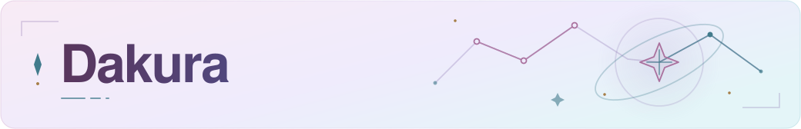
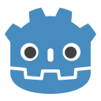

<picture>
  <source media="(prefers-color-scheme: dark)" srcset="assets/header-dark.svg">
  <source media="(prefers-color-scheme: light)" srcset="assets/header-light.svg">
  
</picture>

# Hey, I'm Dakura

**Software Developer | AI Systems & Automation**

*Building intelligent systems for the real world.*

I build software that connects APIs, AI models, and real-world devices. My work spans full-stack applications, business automation, and experimental engineering projects.

[Projects](#featured-projects) · [Technologies](#technology-stack) · [Experience](#professional-experience) · [Connect](#contact--collaboration)

## About me

I'm interested in the engineering behind useful software: connecting services, coordinating workflows, and turning ideas into practical applications. I currently work as a **Code Sensei at Code Ninjas**, teaching programming and game development while also developing automation tools for business operations.

Outside that work, I'm building personal AI systems and exploring applications with long-term product potential. I enjoy learning new stacks and working through the integration challenges that come with them.

## Featured projects

### Jarvis OS

**AI Systems · Automation · Software Engineering**

An evolving personal automation system I'm developing around connected-device control, application and service integrations, and AI-assisted commands. Development focuses on modular functionality, automation orchestration, and system management.

The engineering challenge is coordinating devices, software services, and commands through integrations that can grow with the system.

**Technical focus:** AI-assisted workflows · Device and service integrations · Modular orchestration 
**Availability:** In development; documentation not yet public.

### Code Ninjas Automation

**Professional Software Development · Business Automation**

Automation tools I've developed for use in a Code Ninjas environment. The work covers smart displays and television automation, Spotify integration, scheduling, event information, and AI-assisted promotional content workflows.

My work includes connecting third-party services, deploying integrations, and troubleshooting the technical systems that support day-to-day operations.

**Integrations:** Spotify · Smart displays · Third-party APIs 
**Availability:** Professional work; source and internal implementation details are not public.

### AI & Agent Systems

**Artificial Intelligence · Automation**

My broader work with LLM APIs, tool calling, structured outputs, agents, and embeddings. I explore how these pieces connect with applications and automated workflows, with an interest in reusable integrations and developer tools.

**Technologies and concepts:** LLM APIs · Tool calling · Structured outputs · Agents · Embeddings 
**Availability:** Ongoing work; individual projects are not yet publicly documented.

### Game Development

**Game Development · Programming Education**

Game-development and educational programming projects, alongside teaching interactive software concepts and preparing programming curricula. This work combines hands-on programming with helping students reason through their own projects.

**Tools across this work:** Unity · Unreal Engine 5 · Godot · C# · C++ · JavaScript · Lua 
**Availability:** Project documentation is not yet public.

## Technology stack

Most of my work with these technologies is AI-assisted. I use AI tools to help build projects while continuing to develop my own understanding of the languages and tools. My experience and confidence vary by technology.

### Languages

  
  &nbsp;
  
  &nbsp;
  

C# · C++ · JavaScript · HTML · CSS · Lua · PowerShell · Bash

### Frameworks & development

  
  &nbsp;
  
  &nbsp;
  

.NET · ASP.NET · Node.js · React · Next.js · Flask

### AI & intelligent systems

- **Model interaction:** LLM APIs, tool / function calling, structured outputs, and model orchestration.
- **Retrieval & context:** Embeddings and vector databases.
- **Applications:** AI agents, AI workflow automation, and API integrations.

### Cloud, infrastructure & tools

  
  &nbsp;
  
  &nbsp;
  

Git · GitHub · GitHub Actions · Docker · Linux · AWS · Azure · Supabase · Firebase · SQLite

### Game development

  

Unity · Unreal Engine 5 · Godot

## Professional experience

### Code Ninjas — Code Sensei

I help students learn programming and software development through hands-on projects, while contributing technical tools that support business operations.

- Teach programming concepts and guide students through software and game-development projects.
- Create or contribute to programming curricula and help students break technical problems into manageable steps.
- Develop business automation systems and integrate third-party APIs and software services.
- Troubleshoot, deploy, and improve technical systems used in the learning environment.

## AI engineering focus

I'm most interested in making AI useful beyond a chat interface: connecting LLMs to external tools, applications, and devices so they can support practical tasks. I'm exploring agentic workflows, software and hardware automation, and reusable systems that other applications can build on.

Reliable integrations are central to that direction: defining what a tool can do, exchanging structured data, and understanding how the wider workflow behaves when a service or model doesn't respond as expected.

## Currently building

- **Jarvis OS:** Developing a modular system for AI-powered automation and intelligent device control.
- **AI automation:** Exploring and building tools for software and business workflows.
- **Software products:** Designing practical applications with long-term product potential.

## Contact & collaboration

I'm open to software and AI engineering opportunities, technical collaborations, interesting software projects, and open-source contributions.

**Find me on GitHub:** [@DakuraOfficial](https://github.com/DakuraOfficial)
